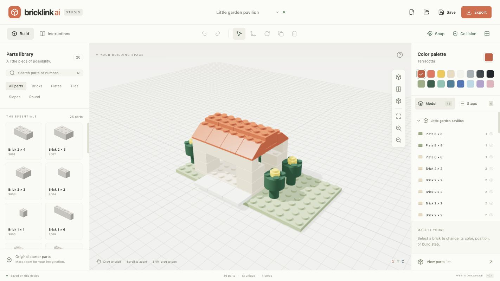
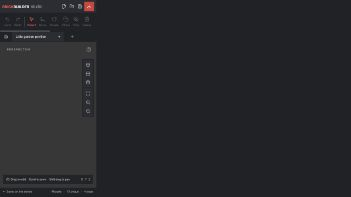
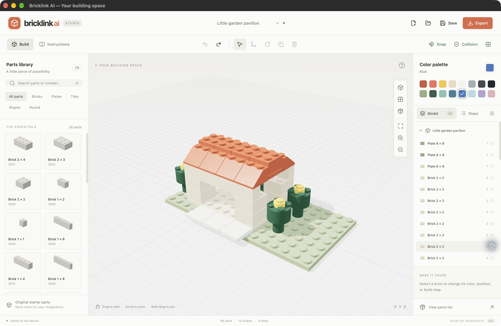

# Verification

Verified locally on an Apple Silicon Mac on October 25, 2026.

## Automated checks

- 62 tests passed across domain validation, collision and placement rules, snapping, inventory/LDraw export, undo/redo, procedural geometry bounds for all 26 parts and four rotations, editor interactions, autosave, step navigation, binary file downloads, application menu actions and dismissal, and migration of the previous browser autosave.
- A clean `npm ci`, TypeScript, and production Vite build passed using Node 24.22.1.
- Peer dependency resolution is explicitly enabled in `.npmrc` so local and CI lockfile behavior match.
- `npm audit --audit-level=moderate`: zero known vulnerabilities.
- Electron source-build smoke test passed.
- Apple Silicon `.app`, `.dmg`, and `.zip` packaging completed.
- Packaged `.app --smoke-test` passed: WebGL canvas present, desktop bridge present, 46 model parts rendered, and `window.require` unavailable.

## Interactive checks

The actual production web build was tested in the Codex in-app browser:

- Create a blank project; choose and place a brick; place another on top (Y = 3 plates).
- Change its color, duplicate it, and pick up/move the duplicate to the ground.
- Download the project, replace the workspace with a blank project, and reopen the saved file; all three parts return.
- Export a PNG, confirm a file downloads, and visually inspect the rendered image.
- Load the 46-part example and step through its instructions.
- Inspect the dark desktop layout and 390 × 844 and 320 × 711 CSS-pixel mobile viewports. Page scroll width matches viewport width; parts drawer works and the complete model fits the narrow canvas.
- Confirm no browser console errors after the final renderer update.

The packaged Mac app was opened from `release/mac-arm64/BrickBuilder Studio.app`. It rendered local assets, allowed selection and recoloring, and restored the prior color through the native Command-Z accelerator.

## Public deployment

- Vercel deployment `dpl_5zpFBusCB4nwTHKbktnZ2XtHMu7d` reports Ready / Production.
- Cloudflare record: `studio.brickbuilder.ai` → `76.76.21.21`, DNS only, automatic TTL. Existing apex, www, and mail records were retained.
- `https://studio.brickbuilder.ai` returns HTTP 200 over valid HTTPS and renders the dark BrickBuilder Studio editor.
- Local and deployed asset hashes match.
- GitHub repository remains `for-real-labs/bricklink-ai`; implementation is on the open feature PR. No production branch merge was performed.

## Verification limits

Mac packages are unsigned and not notarized. Intel Mac, Windows, and Linux builds are configured but have not been tested. LDraw export is covered by transform/unit tests and reference checks; importing that output into the native Studio app has not been verified. The UI follows the native dark build workspace with approximate system typography; it is not a pixel-identical reproduction or the full Studio feature set.

## Version 0.2 round-trip validation

- 85 Studio tests passed, including exact LDraw transforms/colors/steps, nested model expansion, embedded geometry retention, malformed/recursive input rejection, origin/window/nonce transfer checks, safe desktop argument handling, and imported-model autosave behavior.
- The BrickBuilder receiver passed the full 1,218-test frontend suite with 84.54% line coverage, followed by the affected tests after final refinements and a new imported-order UI test. Its production build passed.
- Live Studio → BrickBuilder edit → Studio transfers preserved all 46 pavilion parts. A real AI edit changed the roof to red and produced a 46-piece orderable model and kit quote; no purchase was made.
- The packaged Electron app sent its model into BrickBuilder’s landing-page edit stage through the compressed-fragment handoff.
- Order handoff reached `/order` with the imported model and the required AI parts-validation step.
- LDraw export/reimport rendered the model using LDraw part geometry. Mobile transfer buttons fit within 320px and 390px viewports without page overflow.
- The native launch command started a separate Studio instance with the generated `.io` filepath. Its update dialog prevented the final model-opening check; native import completion remains unverified.

- Version 0.2 source and packaged Electron smoke tests passed; the Apple Silicon ZIP and DMG are published in the [0.2 preview release](https://github.com/for-real-labs/bricklink-ai/releases/tag/v0.2.0). DMG packaging initially ran out of disk space and succeeded after removing obsolete packages created during this task.
- Final Studio deployment `dpl_QdNMwYMbPGz7rwjuhsAYkPPn2k1Z` is Ready and serves the matching built asset hashes at studio.brickbuilder.ai.
- Browser protocol launch could not be confirmed through the browser automation; the native launch and download fallback checks are documented separately above.

## Article publication

Both articles were published publicly on AI and LEGO on Substack, with email and app-inbox delivery disabled, then imported using the existing RSS importer. The source HTML, image credits, links, and screenshots are preserved in `articles/2026-10-25-studio/`.

- [Release announcement](https://brickbuilder.ai/blog/ai-for-bricklink-studio-meet-brickbuilder)
- [Round-trip tutorial](https://brickbuilder.ai/blog/how-to-use-ai-with-bricklink-studio)
- All 38 article/publication tests and the frontend build passed; the article-only boundary check allowed exactly the three generated blog data/manifest/sitemap files.
- Combined integration + article deployment `dpl_GuqdhvtpFu2YetPfaPjPFqYfHjBW` is Ready at brickbuilder.ai. The live manifest contains both articles, and both rendered pages were verified in the browser.
- Studio PR #1 web/desktop CI passed. BrickBuilder integration PR #322 CI passed. Article PR #323 code tests passed; its separate automatic preview failed because the GitHub backend-preview lookup returned HTTP 403. The combined production deployment above succeeded.
- Changes remain on feature branches with PRs open. No production branch was pushed or merged during this task.
